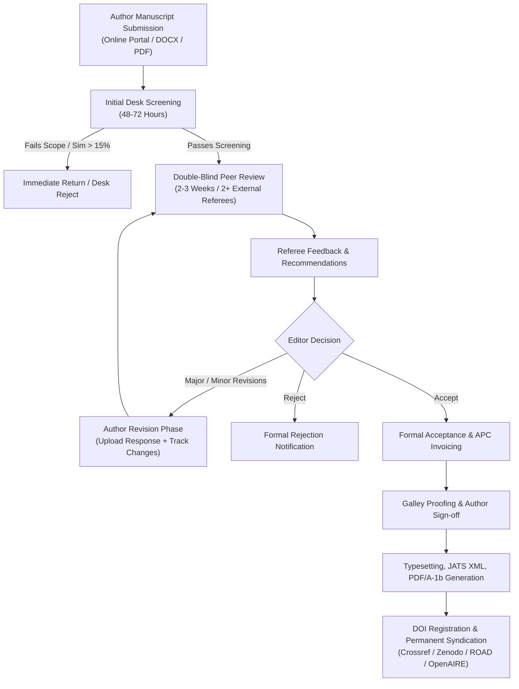

# IJITEST Master Dossier & System Architecture
**International Journal of Innovative Trends in Engineering Science and Technology**
*Official Reference Guide for Development, Editorial Management, and Publishing Operations*

---

## 1. Executive Summary & Journal Identity

| Parameter | Official Specification |
| :--- | :--- |
| **Full Journal Title** | International Journal of Innovative Trends in Engineering Science and Technology |
| **Abbreviated Title / Acronym** | IJITEST |
| **Official E-ISSN** | **3139-6887** (Online) — Registered via ISSN International Centre & ROAD |
| **Publisher** | **Felix Academic Publications** |
| **MSME / Udyam Registration** | `UDYAM-AP-10-0125617` (Government of India) |
| **Publication Frequency** | Monthly (12 regular issues per volume per calendar year) |
| **Inaugural Launch Year** | **2026** (Volume 1) |
| **Format & Access Type** | Electronic / Online Only — 100% Gold Open Access |
| **Licensing** | Creative Commons Attribution 4.0 International (**CC BY 4.0**) |
| **Digital Object Identifiers (DOI)** | Hybrid: **Crossref** (`10.68139/ijitest.*`) & **CERN Zenodo** (`10.5281/zenodo.*`) |
| **Primary Website** | [https://ijitest.org](https://ijitest.org) |
| **Official Support Email** | `support@ijitest.org` |
| **Editorial Desk Email** | `editor@ijitest.org` |
| **Direct Contact / WhatsApp** | `+91 8919643590` |
| **Registered Headquarters** | Dr. Ravibabu T., Felix Academic Publications, Madhurawada, Visakhapatnam, Andhra Pradesh, India - 530048 |

---

## 2. Aims, Scope & Academic Disciplines

IJITEST is a multidisciplinary, peer-reviewed international forum publishing high-impact theoretical discoveries, experimental analyses, computational modeling, and industrial engineering applications.

### 2.1 Focus Disciplines
1. **Computer Science & Information Technology**:
   - Artificial Intelligence, Machine Learning, Deep Neural Architectures, NLP.
   - Cloud Computing, Distributed Systems, Edge Computing, DevOps.
   - Cyber Security, Cryptography, Blockchain, Quantum Computing.
   - Big Data Engineering, Data Mining, Predictive Analytics.
2. **Electronics & Communication Engineering**:
   - VLSI Design, Embedded Systems, IoT, Robotics & Mechatronics.
   - Signal Processing, Telecommunications, 5G/6G Networks, Antenna Design.
   - Optical Communication, Microwave & Radar Engineering.
3. **Electrical & Renewable Energy Systems**:
   - Power Systems, Smart Grid Technology, High Voltage Engineering.
   - Solar, Wind, and Hybrid Renewable Energy Solutions, Electric Vehicles (EV).
4. **Mechanical & Civil Infrastructure**:
   - Fluid Dynamics, Thermal Engineering, CAD/CAM, Manufacturing Automation.
   - Structural Engineering, Geotechnical Analysis, Green Concrete, Transportation Systems.
5. **Applied Sciences & Interdisciplinary Domains**:
   - Applied Physics, Applied Chemistry, Computational Mathematics & Modeling.
   - Biomedical Engineering, Healthcare Informatics, Environmental Sustainability.
6. **Management Sciences & Technology Governance**:
   - Technology Management, Business Analytics, Supply Chain Optimization, Information Systems.

### 2.2 Accepted Manuscript Formats
- **Original Research Articles**: Substantive empirical or mathematical papers presenting new results (standard length: 6–10 pages).
- **Review Papers / Systematic Surveys**: In-depth state-of-the-art syntheses of emerging engineering topics.
- **Short Communications & Case Studies**: Rapid, high-priority empirical findings or technical case analyses.

---

## 3. Editorial Leadership & Governance

IJITEST enforces strict independence between editorial determinations and commercial publishing management.

### 3.1 Editor-in-Chief
- **Dr. Ravibabu T.**
  - Associate Professor, Department of Electronics and Communication Engineering
  - MES Group of Institutions, Vizianagaram / Madhurawada, Visakhapatnam, Andhra Pradesh, India
  - Primary Contact: `editor@ijitest.org` | `rthorlapati@miracleeducationalsociety.com`

### 3.2 Key International Editorial Board Members
- **Dr. Y. Prasanna Kumar** — Professor, School of Mining Engineering, Papua New Guinea University of Technology, Morobe Province, Papua New Guinea (`prasanna.ky@pnguot.ac.pg`).
- **Dr. Sreenu Naik Bhukya** — Assistant Professor, Department of CSE, National Institute of Technology Calicut (NITC), Kerala, India (`bsnaik_81@nitc.ac.in`).
- **Prof. Basim Alhadidi** — Professor, Computer Information Systems Department, Al-Balqa Applied University, Al-Salt, Jordan (`b_hadidi@bau.edu.jo`).
- **Assoc. Prof. Ir. Gs. Ts. Dr. Norsuzila Ya'acob** — School of Electrical Engineering, Universiti Teknologi MARA (UiTM), Shah Alam, Selangor, Malaysia (`norsuzila@uitm.edu.my`).
- **Dr. Oguz Kucur** — Professor, Department of Electronics Engineering, Gebze Technical University, Turkey (`okucur@gtu.edu.tr`).
- **Dr. CH. Swapna Priya** — Associate Professor, Dept of CSE, Vignan's Institute of Information Technology, Visakhapatnam, India (`swapnavignan@vignaniit.edu.in`).
- **Dr. S. Nagamallik Raj** — Associate Professor, Dept of CSE, Vignan's Institute of Information Technology, Visakhapatnam, India (`mallikrajvignan@vignaniit.edu.in`).
- **Dr. Mahendra Narla** — Assistant Professor, Dept of AI & Data Science, G. Pullaiah College of Engineering & Technology (GPCET), Kurnool, India (`narlamahendracai@gpcet.ac.in`).

---

## 4. Peer Review Architecture & Editorial Workflow



### 4.1 Operating Timelines
- **Desk Screening & Similarity Check**: 48 to 72 hours.
- **Double-Blind Referee Review**: 2 to 3 weeks (two independent domain experts).
- **Final Decision Notice**: 4 to 6 weeks from submission.
- **Galley Proofing & Production**: 4 to 5 days post-acceptance.

### 4.2 Formatting & Submission Standard
- **Layout**: Two-column IEEE format (8.5" × 11" US Letter).
- **Margins**: Top 0.7", Bottom 0.7", Left 0.6", Right 0.6", Column spacing 0.2".
- **Typography**: Times New Roman 10pt (Body), Bold 14pt (Title), Bold 10pt (Headings).
- **Authors**: Maximum of 5 authors per paper.
- **Accepted File Formats**:
  - **Manuscripts (Initial, Revised, Camera-Ready)**: **`.docx` ONLY** (Mandatory for automated PDF proof generation, blind-review anonymization, and JATS 1.3 XML typesetting).
  - **Reviewer Rebuttals & Author Responses**: Accepts **`.docx` and `.pdf`**.
  - **Signed Copyright Form**: Accepts **`.docx` and `.pdf`**.
  - **Payment Receipts / UTR**: Accepts **`.pdf`, `.png`, `.jpg`, `.jpeg`**.
- **Templates**: Standard `.docx` format downloadable directly from `/guidelines`.

---

## 5. Article Processing Charges (APC) & Financial Policy

To ensure complete transparency under **DOAJ Principles of Transparency** and **OASPA**:
- **Submission Fee**: **₹0 / $0 (100% Free)**.
- **Editorial Processing Fee**: **₹0 / $0 (100% Free)**.
- **Article Processing Charge (APC)**: Billed **only after formal acceptance**.
  - **Indian Authors**: **₹2,500 INR** (covers up to 5 authors, standard 8 pages).
  - **International Authors**: **$50 USD**.
  - **Excess Page Charge**: ₹500 INR / $10 USD per page beyond 8 pages.
  - **Color Figures & Supplementary Files**: ₹0 (No surcharge).
- **Inaugural Volume 1 (2026) Promotion**: 100% full fee waiver available for high-fidelity technical papers during designated promotional windows.
- **Waiver Program**: Authors from World Bank low-income countries qualify for up to 100% discretionary fee relief.

---

## 6. Scholarly Indexing & Global Metadata Syndication

### 6.1 Active & Verified Indexations
1. **ISSN International Centre (ROAD)**:
   - E-ISSN: `3139-6887`
   - Direct record: Listed in the UNESCO ROAD open-access directory.
2. **Crossref (Official Member)**:
   - Publisher Member Prefix: `10.68139`
   - XML Schema: Crossref 5.3.1 deposit via direct HTTPS API servlet.
3. **Zenodo (CERN / OpenAIRE Hub)**:
   - Dedicated repository community: `zenodo.org/communities/ijitest`
   - DOI Prefix: `10.5281/zenodo.*`
   - Direct REST API deposition and perpetual preservation.
4. **OpenAIRE EXPLORE**:
   - European research infrastructure indexing all Zenodo-syndicated outputs.
5. **Semantic Scholar (Allen Institute for AI - AI2)**:
   - Automated paper harvesting and citation network indexing.
6. **Google Scholar**:
   - Full automated crawling via Dublin Core & Highwire Press `<meta>` tags.

### 6.2 Evaluations In Progress & Third-Party Metrics
1. **SJIFactor (Scientific Journal Impact Factor)**:
   - **Status**: Under evaluation (SJIF 2026).
   - **Official Passport ID**: **`25877`**
   - **Public Verification Link**: `https://sjifactor.com/passport.php?id=25877`
2. **DOAJ (Directory of Open Access Journals)**:
   - Onboarding evaluation in progress.
3. **OpenAlex**:
   - Next-gen research graph integration in progress.
4. **CiteFactor**:
   - Formal application under evaluation.

---

## 7. Ethics, Compliance & Academic Integrity

IJITEST strictly complies with the guidelines of the **Committee on Publication Ethics (COPE)**, **WAME**, and **ICMJE**:

1. **Plagiarism & Similarity Thresholds**:
   - Screened using Turnitin / iThenticate.
   - **Overall Similarity**: Must be **< 15%** (excluding citations and mathematical definitions).
   - **Single Source Match**: Must be **≤ 2%**.
2. **Generative AI Policy (2024 DOAJ / COPE Compliance)**:
   - AI tools (ChatGPT, Claude, Gemini, etc.) **cannot be credited as authors** (lack of legal accountability).
   - AI usage for editing, grammar, or brainstorming is permitted but **must be explicitly declared** in an *"AI and AI-Assisted Technologies Statement"* preceding references.
   - Generation of synthetic empirical datasets, artificial micrographs, or fabricated research readings is strictly prohibited.
3. **Corrections & Retractions**:
   - Minor typos: Pre-indexing PDF amendment (within 48 hours).
   - Post-indexing errors: Formal Erratum / Corrigendum linked to the DOI.
   - Unethical practices / Fabricated data: Formal Retraction with permanent public notice.

---

## 8. Technical Architecture & Codebase Overview

### 8.1 Stack & Frameworks
- **Framework**: Next.js 15+ (App Router, React 19, Server Actions, Server Components).
- **Styling**: Tailwind CSS v4, Lucide Icons, Framer Motion.
- **Database**: MariaDB / MySQL (`u116573049_ijitest_db` on Hostinger cloud infrastructure `srv604.hstgr.io:3306`).
- **ORM / Query Layer**: Drizzle ORM / Native MySQL connection pool.
- **Authentication**: NextAuth.js (Role-based access: `admin`, `editor`, `reviewer`, `author`).
- **Document Handling**: PDF generation via `pdf-lib`, DOCX parsing via `mammoth`.

### 8.2 Application Directory Structure
```
IJITEST/
├── public/                 # Static assets, slides, icons, llms.txt, llms-full.txt
├── src/
│   ├── actions/            # Server Actions (archives, publications, settings, doi, paypal)
│   ├── app/
│   │   ├── (auth)/         # /login, /review/invitation, password recovery
│   │   ├── (main)/         # Public journal portal (39 public routes)
│   │   │   ├── about/
│   │   │   ├── aims-scope/
│   │   │   ├── announcements/
│   │   │   ├── apc-fees/
│   │   │   ├── archives/
│   │   │   ├── contact/
│   │   │   ├── current-issue/
│   │   │   ├── editorial-board/
│   │   │   ├── ethics/
│   │   │   ├── faqs/
│   │   │   ├── guidelines/
│   │   │   ├── indexing/
│   │   │   ├── join-us/
│   │   │   ├── payment/
│   │   │   ├── peer-review/
│   │   │   ├── policies/
│   │   │   ├── submit/
│   │   │   └── track/
│   │   ├── (panel)/        # Role-based authenticated dashboards
│   │   │   ├── admin/      # Editorial & publishing administration
│   │   │   ├── editor/     # Manuscript assignments & decisioning
│   │   │   ├── reviewer/   # Referee review dossiers & evaluation forms
│   │   │   └── author/     # Author manuscript tracking & revisions
│   │   ├── api/            # API routes (OAI-PMH, SUSHI, JATS/PubMed/DOAJ XML, feeds)
│   │   └── layout.tsx      # Root layout, fonts, SEO & OpenGraph tags
│   ├── components/         # Shared UI, layout headers, navbar, footer, JSON-LD
│   ├── db/                 # Schema definitions, defaults, protocols, connection pool
│   ├── features/           # Domain-driven modular features (archives, policies, indexing)
│   └── lib/                # XML generators (JATS, PubMed, DOAJ), auth, email, cache
```

### 8.3 Core Database Tables
- `journal_settings`: Master configuration (name, ISSN, APC, addresses, prefixes, templates).
- `publications`: Published research papers, metadata, file paths, citations, DOIs, dates.
- `volumes_issues`: Volume and issue tracking, month ranges, publication dates.
- `submissions`: Author manuscript submission tracking, revisions, statuses, reviewer assignments.
- `peer_reviews`: Reviewer dossiers, evaluation scores, comments, recommendations.
- `announcements`: Public scholarly bulletins, CFPs, editorial alerts.
- `users` & `user_profiles`: User identity, hashed passwords, roles, affiliations, ORCID.

### 8.4 Automated Endpoints & Cron Jobs
- **OAI-PMH Protocol**: `/api/oai` — Dublin Core XML metadata harvester for digital repositories.
- **COUNTER / SUSHI**: `/api/sushi` — Standard institutional usage reporting (TR, IR).
- **XML Syndication Pipelines**:
  - `/api/export/jats/[paperId]` — JATS 1.3 XML.
  - `/api/export/pubmed/[paperId]` — PubMed MEDLINE 2.8 XML.
  - `/api/export/doaj/[paperId]` — DOAJ 0.2 XML.
  - `/api/export/crossref/[paperId]` — Crossref Schema 5.3.1 XML batch.
- **RSS & Atom Feeds**: `/api/feed/rss` and `/api/feed/atom`.
- **Background Cron Tasks**:
  - `/api/cron/crossref-status` — Polling Crossref deposit ticket verification.
  - `/api/cron/review-reminders` — Automated notifications to invited referees.
  - `/api/cron/cleanup` — Temporary upload file cleanup.

---

## 9. Key URLs & Direct Resource Links

- **Main Journal Portal**: [https://ijitest.org](https://ijitest.org)
- **Current Issue**: [https://ijitest.org/current-issue](https://ijitest.org/current-issue)
- **Digital Archives**: [https://ijitest.org/archives](https://ijitest.org/archives)
- **Manuscript Submission**: [https://ijitest.org/submit](https://ijitest.org/submit)
- **Author Guidelines**: [https://ijitest.org/guidelines](https://ijitest.org/guidelines)
- **Publication Fees (APC)**: [https://ijitest.org/apc-fees](https://ijitest.org/apc-fees)
- **Indexing & Repositories**: [https://ijitest.org/indexing](https://ijitest.org/indexing)
- **Editorial Board**: [https://ijitest.org/editorial-board](https://ijitest.org/editorial-board)
- **Publication Ethics**: [https://ijitest.org/ethics](https://ijitest.org/ethics)
- **SJIF Live Passport**: [https://sjifactor.com/passport.php?id=25877](https://sjifactor.com/passport.php?id=25877)
- **ROAD ISSN Registry**: [https://road.issn.org](https://road.issn.org)
- **Zenodo Community**: [https://zenodo.org/communities/ijitest](https://zenodo.org/communities/ijitest)
- **OpenAIRE Direct Record**: [https://explore.openaire.eu/search/result?pid=10.5281%2Fzenodo.22016453](https://explore.openaire.eu/search/result?pid=10.5281%2Fzenodo.22016453)
- **Crossref Member Portal**: [https://www.crossref.org](https://www.crossref.org)
